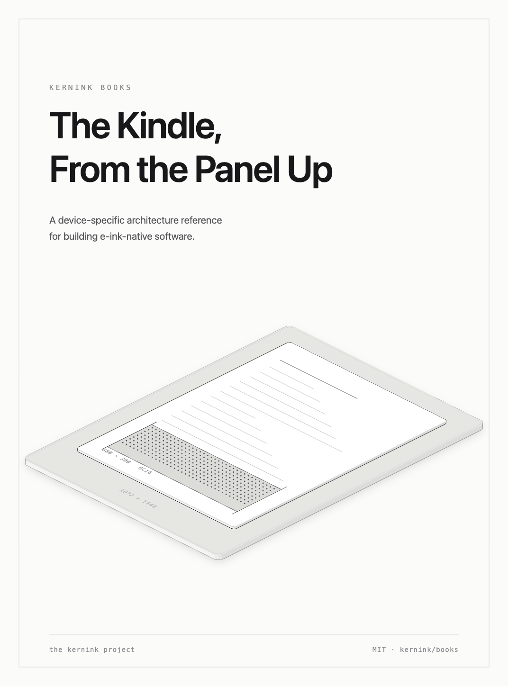

# kernink books

The research books of the [kernink](https://github.com/kernink) project. A book is a top-level
directory named after the book, and every entry has the same two things:

```
<book>/
├── <book>.epub    the release — committed, so a reader needs nothing but a Kindle
└── src/           everything the release is built from
```

The EPUB is committed deliberately: the artifact is what a reader wants, and having it in the tree
means `git clone` (or a single file download) is the whole reading experience. Rebuild it whenever
`src/` changes, so the copy here is never stale. Nothing in `src/` writes to a device.

## The Kindle, From the Panel Up



A device-specific architecture reference for building e-ink-native software: chapters on
the hardware, boot, kernel, display and EPDC, input and multitouch, power and sleep, the userspace
stack, storage, the wider ecosystem and its licences, the build and deployment path, and finally
what all of it implies for the architecture that will run on it.

It is device-specific on purpose. Where the public record and the device disagreed, the device
won, and the write-up says which is which.

- Read it on GitHub:
  [`the-kindle-from-the-panel-up/src/README.md`](the-kindle-from-the-panel-up/src/README.md)
- Download it:
  [`the-kindle-from-the-panel-up/the-kindle-from-the-panel-up.epub`](the-kindle-from-the-panel-up/the-kindle-from-the-panel-up.epub)
- Build it: `cd the-kindle-from-the-panel-up/src && ./make-epub.sh`
- The isometric figures:
  [`the-kindle-from-the-panel-up/src/figures/`](the-kindle-from-the-panel-up/src/figures/)

The figure PNGs are committed, so the build needs nothing but `pandoc`. `node figures/render.mjs`
re-renders them, and `node cover.mjs` re-renders the cover; both are only needed after changing a
`.mjs`.

## Adding a book

Copy the shape of an existing entry: a directory named after the book, holding a `src/` with the
chapters, a `README.md` that is both the front matter and the prose house rules, a `metadata.yaml`
that pins its `identifier:`, a `make-epub.sh` that derives the artifact name from the directory it
sits in, and the built `<book>.epub` beside `src/`. Conventions are in [`AGENTS.md`](AGENTS.md).

## Licence

MIT.
